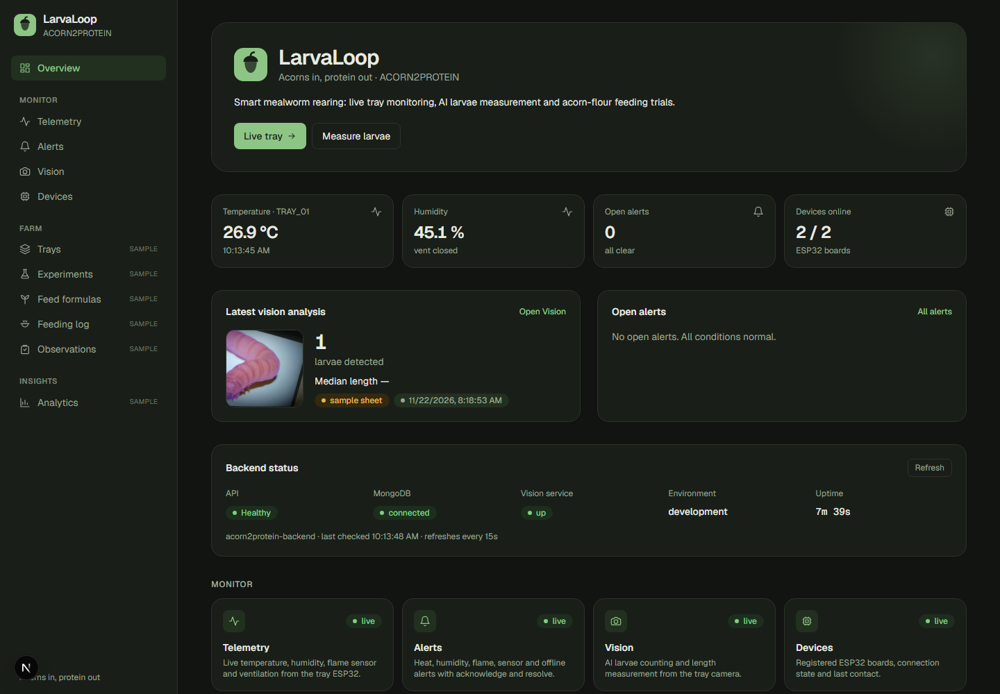
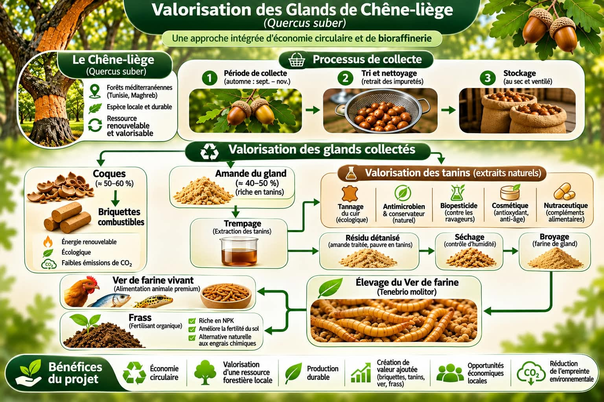
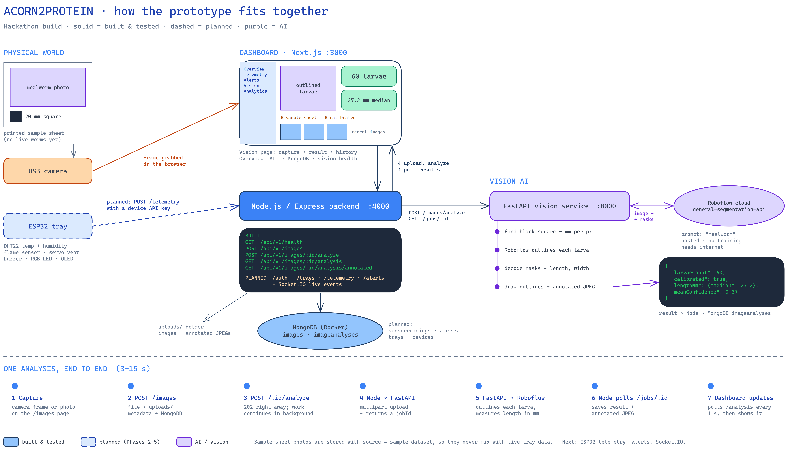
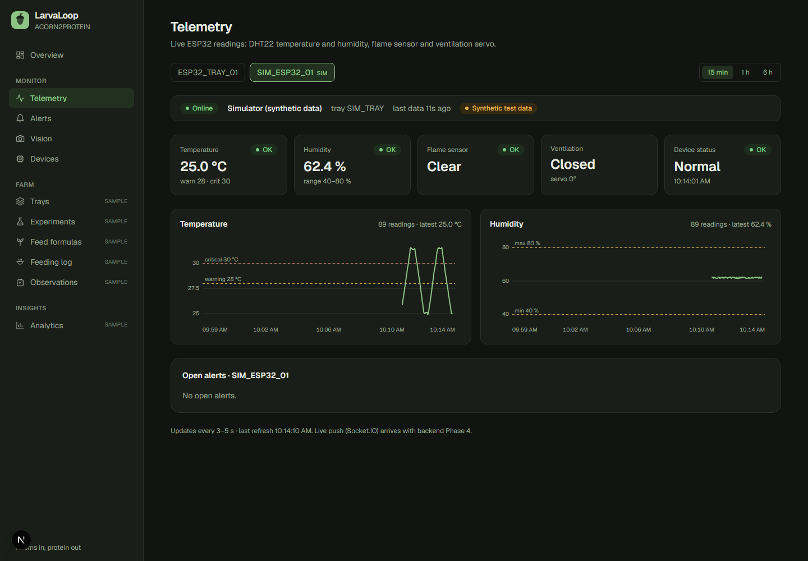
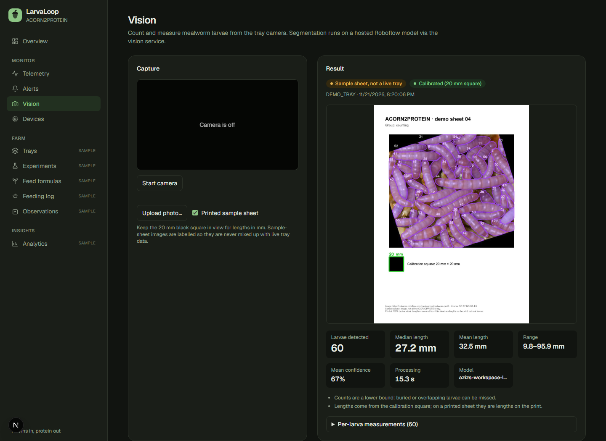
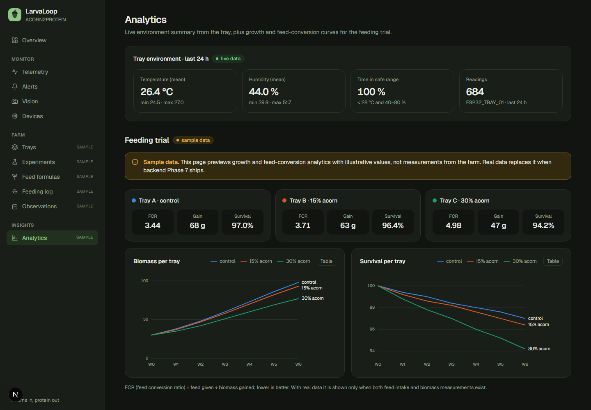
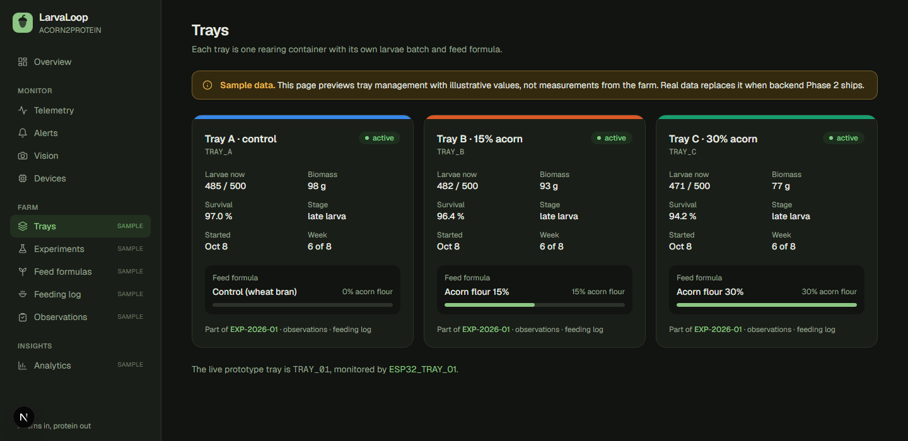

# LarvaLoop

**Acorns in, protein out.** A smart mealworm farm that turns cork-oak acorns into insect protein, with live
IoT monitoring of the rearing tray, AI larvae measurement from a camera, and a dashboard for feeding trials.

Built for the **ACORN2PROTEIN** project.



---

## The idea

Cork oak (*Quercus suber*) forests across Tunisia and the Maghreb drop tonnes of acorns every autumn that are
barely used. ACORN2PROTEIN turns them into a circular value chain: shells become fuel briquettes, the kernel
gives natural tannins, and the detannified acorn flour becomes feed for **mealworms** (*Tenebrio molitor*).
The larvae are sold as premium animal feed, and their frass goes back to the soil as fertiliser.



**LarvaLoop is the farm-side system** of that chain: it keeps the larvae in good conditions, measures how they
grow, and records feeding trials so we can tell whether acorn flour is a good feed.

## What we built

| Part | What it does | Folder |
|---|---|---|
| **Smart tray (ESP32)** | Reads temperature, humidity and a flame sensor every few seconds. Opens a vent servo when it gets hot, sounds a buzzer on fire, shows status on an OLED and RGB LED, and sends every reading to the server over Wi-Fi. | [`firmware/`](firmware) |
| **Backend API** | Stores readings, raises and auto-resolves alerts (heat, humidity, flame, sensor failure, device offline), stores camera images and their AI results. | [`backend/`](backend) |
| **Vision service** | Finds each larva in a photo, counts them and measures their length in millimetres using a 20 mm reference square. | [`vision/`](vision) |
| **Dashboard** | Live tray view, alerts, camera capture with AI results, devices, and feeding-trial pages. | [`dashboard/`](dashboard) |

New to the app? **[docs/how-it-works.md](docs/how-it-works.md)** explains every page and card in plain words.

## How it works



1. **Sensors → alerts.** The ESP32 posts a JSON reading every 5 s. The backend saves it and checks thresholds
   (28 °C warning, 30 °C critical, humidity 40–80 %, flame, missing sensor values). One alert per ongoing
   problem; it closes by itself when conditions recover. No data for 30 s marks the tray offline.
2. **Camera → measurement.** A frame from the USB camera goes to the backend, then to the vision service. A
   segmentation model outlines each larva, the black 20 mm square sets the scale, and the result (count, length
   in mm, annotated image) is saved and shown on the dashboard.
3. **Dashboard.** Shows everything live (refreshes every few seconds) and keeps the history.

The ESP32 keeps its own safety logic (vent, buzzer, LED), so the tray stays safe even without Wi-Fi.

## Screenshots

| Live tray | AI larvae measurement |
|---|---|
|  |  |

| Feeding-trial analytics | Trays |
|---|---|
|  |  |

## What is real and what is sample data

We keep this explicit, in the app and here:

| Live (real data) | Sample (illustrative, labelled in the app) |
|---|---|
| Telemetry, alerts, devices, tray environment summary, AI vision | Trays, experiments, feed formulas, feeding log, observations, growth and FCR charts |

Sample pages show a yellow **"Sample data"** banner. They preview features whose backend is planned next; their
values are never stored in the database. For the vision demo without live larvae we photograph **printed photos**
from public mealworm datasets, and those images are tagged `sample_dataset`.

## Run it locally

Requirements: Node 20+, Python 3.11+, Docker (for MongoDB).

```bash
docker run -d --name a2p-mongo -p 27017:27017 mongo:7

# backend (:4000)
cd backend && cp .env.example .env && npm install && npm run dev

# vision service (:8000)  — on macOS/Linux use .venv/bin/ instead of .venv/Scripts/
cd vision && python -m venv .venv && .venv/Scripts/pip install -r requirements.txt
cp .env.example .env && .venv/Scripts/python -m uvicorn app.main:app --port 8000

# dashboard (:3000)
cd dashboard && cp .env.example .env.local && npm install && npm run dev
```

- Set real secrets in `backend/.env` (16+ characters) and a Roboflow API key in `vision/.env`.
- Register the tray: `cd backend && npm run device:register -- ESP32_TRAY_01 TRAY_01`, then put the key in
  `dashboard/.env.local` (`LEGACY_DEVICE_KEYS`) or in the firmware.
- No hardware? `npm run simulate -- heat` in `backend/` sends synthetic readings from a separate test device.

Device protocol: [docs/device-protocol.md](docs/device-protocol.md) · Vision details: [docs/vision.md](docs/vision.md) ·
Judges: [docs/demo-guide.md](docs/demo-guide.md)

## Tech stack

ESP32 (Arduino, DHT22, flame sensor, SG90 servo, SH1106 OLED) · Node.js, Express, MongoDB, Mongoose, Zod, Pino ·
Python, FastAPI, OpenCV · Roboflow hosted segmentation · Next.js, React, TypeScript, Tailwind CSS.

## Limitations (honest list)

- Counts from images are a lower bound: buried or overlapping larvae are missed. In dense piles the model finds
  about 40 % of larvae; in small groups about 93 %.
- The vision model is a general hosted segmenter, not yet trained on our own trays, and needs internet.
- Dashboard routes have no login yet (planned next). Live updates use polling; Socket.IO is planned.
- Feeding-trial pages use sample data until their backend ships.

## Credits

- Mealworm photos for the vision demo: Roboflow Universe datasets
  [mealworm-part1](https://universe.roboflow.com/mealworms/mealworm-part1) and
  [mealworm-part2](https://universe.roboflow.com/mealworms/mealworm-part2) (CC BY-NC-SA 4.0). Not included in this
  repository: download them into `vision/data/`, then `vision/scripts/make_print_sheets.py` builds printable
  sheets with attribution on each page.
- Segmentation: Roboflow serverless `general-segmentation-api` workflow.

## Team

<!-- Add team members here -->

## License

Code: [MIT](LICENSE). Dataset images keep their own licence (CC BY-NC-SA 4.0).
